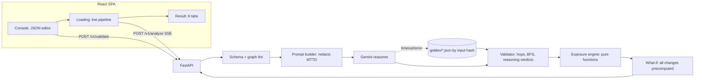

# TRD: Financial Attack Path Intelligence (FAPI)

| Field | Value |
|---|---|
| Author | Jaxz |
| Status | Draft (rewritten for the new 3-page frontend) |
| Version | 0.3 |
| Last updated | 10 Oct 2026 |
| Related PRD | PRD-financial-attack-path-intelligence.md (needs the FR-13 to FR-18 delta in §1) |
| Design source | Claude Design artifact "FAPI" (Console → Loading → Result, 6 tabs) |

## 1. Overview & scope

The app now runs in three steps. **Input:** the user keys in, or loads, a JSON bank environment. For the hackathon, that JSON stands in for the real database. **Loading:** the backend streams each pipeline stage live, so judges can see exactly what goes into Gemini, what comes back, and what the validator accepts or rejects. **Result:** the six-tab report (Verdict, Attack path, Timeline, AI reasoning, Show me why, What-if). The rule that drives everything is unchanged: Gemini reasons, and code owns every number.

This version covers PRD FR-1 to FR-11 and adds the requirements below. The PRD should be updated to match.

| New ID | Requirement | Priority |
|---|---|---|
| FR-13 | User can paste, edit or load a sample JSON environment and get schema errors before analysis | Must |
| FR-14 | Loading page shows each pipeline stage live, including the exact payload sent to Gemini and its raw structured reply | Must |
| FR-15 | Timeline tab shows kill-chain phases per hop, the detection lines from config MTTD, and the cumulative loss curve | Must |
| FR-16 | AI reasoning tab shows each model reasoning step with a server verdict (accepted / corrected / rejected), plus the AI's loss estimate next to the engine figure | Must |
| FR-17 | What-if offers several predefined changes, including an "evidence gap" change that demonstrates UNKNOWN handling | Must (FR-11 promoted) |
| FR-18 | Custom JSON still produces a verdict when Gemini is unavailable (engine-only result) | Should |

**What changes from v0.1:**

| Area | v0.1 | v0.3 |
|---|---|---|
| Input | `bank.json` baked into the image | JSON in the request body, with the sample shipped as the default |
| Analyze | One blocking `POST /api/analyze` | `POST /v1/analyze` streams stage events (SSE over fetch) |
| Gemini output | Hops, techniques, narrative | Adds phases, reasoning steps, an AI loss estimate and an MTTD estimate |
| What-if | One change, one endpoint call | Four changes, all precomputed in the analyze result |
| Cache | One `golden_path.json` | Golden outputs keyed by an input hash, plus an engine-only fallback |

Out of scope: auth, persistence of runs, graph editing UI (the input is a JSON text editor only), and more than ~50 nodes.

> ⚠️ Assumption: The input page ("Key in JSON" → `FAPI Console.dc.html`) is not in the shared design bundle. §5 and TR-1 specify it from your description: a JSON editor prefilled with the sample, with Validate and Analyze buttons.

## 2. Architecture



| Component | Responsibility |
|---|---|
| Schema + lint | Pydantic `extra=forbid` model. It also checks graph integrity: edges point to existing nodes, the entry node exists, IDs are unique. It warns about factors that will be UNKNOWN. |
| Prompt builder | Serializes the graph for Gemini and **removes `mttd_hours` and `mttd_evidence`**, so the model's detection estimate is independent and can be corrected (see §4.3). The exact payload is emitted as the `ai_input` event. |
| Gemini reasoner | One structured-output call (`response_schema=AttackAnalysis`, temperature 0), with an 8 s timeout. |
| Validator | Checks every hop against an `allowed` edge, checks `systems_reached` against the code BFS result, and assigns a verdict to each reasoning step using fixed rules (§4.4). |
| Exposure engine | Pure functions `engine/exposure.py` with rules D-1 to D-5 (§4.2). No I/O and no LLM. |
| What-if | Runs every predefined change on a deep copy of the graph (BFS, then the engine) and returns the before and after for each. No Gemini call. |
| SPA | Three routes: `/` (console), `/run` (loading), `/result` (tabs). The result is held in client state. Nothing is stored on the server. |

**Deployment:** one Docker image. FastAPI serves the built SPA, giving a single Cloud Run service with no CORS. The service is stateless, because the full result travels back to the client in the stream, so it scales without sticky sessions.

## 3. Tech stack & rationale

| Layer | Choice | Why | Alternative considered |
|---|---|---|---|
| Frontend | React + Vite + TypeScript + Tailwind | Fast to build; matches the design's component structure | Next.js (SSR not needed) |
| JSON editor | CodeMirror 6 (`@uiw/react-codemirror`, JSON mode + lint) | Inline error markers from the `/v1/validate` paths | Plain `<textarea>` (no error positions) |
| Graph viz | Custom SVG (as in the design) | The design already uses fixed-position bezier edges; 13 nodes need no library | React Flow (heavier, restyling cost) |
| Charts | Inline SVG paths (loss curve, timeline bars) | The design hand-draws both; no chart library needed | Recharts |
| Streaming | SSE frames over `fetch()` + `ReadableStream` | Works with POST bodies, unlike `EventSource`, and Cloud Run streams chunked responses | WebSockets (overkill) |
| Backend | Python 3.12 + FastAPI + Pydantic v2 | Unchanged; `StreamingResponse` for SSE | Go |
| Graph | NetworkX | BFS and simple-path enumeration | Hand-rolled (fine too: ~40 lines) |
| AI | Gemini via `google-genai`, structured output | Required by the hackathon rules | — |
| Storage | None at runtime; the sample and golden outputs are repo files | This stage of the hack uses JSON as the "DB" | SQLite |
| Hosting | Cloud Run + Secret Manager | Required by the hackathon rules | — |

> ⚠️ Assumption: The design shows `gemini-2.5-pro · temp 0`. Confirm which model ID is current in AI Studio at build time, and pick Flash if Pro's latency breaks the 10 s budget (NFR-3).

## 4. Data model

### 4.1 Input JSON (`ScenarioInput`) — the "DB" for this stage

```jsonc
{
  "scenario_id": "northbank-demo",
  "entry": "vendor-portal",
  "nodes": [
    { "id": "payments-core", "name": "payments-core", "type": "financial",   // external|identity|build|financial|data|process|service
      "criticality": "critical",                                             // medium|high|critical
      "critical_function": true,
      "transaction_limit_usd": 2500000,                                      // financial nodes only
      "mttd_hours": 18, "mttd_evidence": "SOC runbook PAY-04, 90-day median",
      "x": 600, "y": 80 }                                                    // optional layout hint
  ],
  "edges": [
    { "edge_id": "e2", "source": "vendor-svc-account", "destination": "payments-core",
      "permission": "payment_write", "allowed": true,
      "control_bypass_probability": 0.8,                                    // missing → UNKNOWN
      "evidence": "Scope granted Nov 2025 for a one-off migration and never revoked. CHG-4471." }
  ],
  "rules":    { "disruption_hours": { "critical": 72, "high": 24, "medium": 8 }, "materiality_threshold_usd": 100000 },
  "what_ifs": [
    { "id": "revoke-payment-write", "label": "Revoke payment_write", "op": "remove_edge", "target": "e2", "effort_hours": 1, "note": "…" },
    { "id": "clear-evidence", "label": "Evidence gap: refunds-api MTTD unknown", "op": "clear_evidence", "target": "refunds-api", "field": "mttd_hours", "effort_hours": 0, "note": "…" }
  ]
}
```

Limits: ≤ 50 nodes, ≤ 150 edges, ≤ 64 KB body, and every free-text field ≤ 500 characters. If `x` and `y` are missing, the SPA lays nodes out in columns by BFS depth from `entry`. `rules` and `what_ifs` are optional; when absent, the defaults are taken from `rules.default.json`.

### 4.2 Engine rules (as approved 19 Sep 2026, with IDs shown in Show me why)

```
D-1  limit(s)        = node.transaction_limit_usd
D-2  detection_gap(s)= min(mttd_hours / 24, 1.0)                 # missing → UNKNOWN → 1.0
D-3  path_bypass(s)  = max over simple paths entry→s of Π edge.control_bypass_probability   # missing p → 1.0, UNKNOWN
     exposure(s)     = limit × detection_gap × path_bypass
     total           = Σ exposure(s) over reachable financial nodes
D-4  disruption      = max disruption_hours[criticality] over ALL reached nodes
     cyber_risk      = HIGH if any critical reached; MEDIUM if any high; else LOW
D-5  regulatory      = MATERIAL if any critical_function reached AND total ≥ threshold, else BELOW
     complete        = false if any UNKNOWN factor was used → UI shows "up to $X" + INCOMPLETE
```

Expected values for the demo graph, used as test fixtures:

| Change | Total | Disruption | Cyber | Regulatory | Avoided | Effort | Per hour |
|---|---|---|---|---|---|---|---|
| Current | $2,300,000 (payments $1.5M + refunds $0.8M) | 72h | HIGH | MATERIAL | — | — | — |
| revoke-payment-write (e2) | $800,000 | 24h | MEDIUM | BELOW | $1,500,000 | 1h | $1,500,000 |
| revoke-refund-write (e3) | $1,500,000 | 72h | HIGH | MATERIAL | $800,000 | 6h | $133,333 |
| rotate-vendor-key (e1) | $0 | 0h | LOW | BELOW | $2,300,000 | 3h | $766,667 |
| clear-evidence (refunds MTTD) | up to $3,100,000 · INCOMPLETE | 72h | HIGH | MATERIAL | +$800,000 unmeasured | — | — |

Note on D-4: `core-ledger-db` (critical, reached via e5) also counts toward disruption. This is intended, but expect a judge to ask about it.

### 4.3 Gemini response schema (`AttackAnalysis`)

| Field | Shape | Used by |
|---|---|---|
| `paths[].steps[]` | `{from, to, evidence_edge, technique, mitre_id}` | Attack path hops |
| `systems_reached` | `string[]` | BFS cross-check |
| `phases[]` | `{phase, tactic_id, edge_id?, start_h, end_h, detail}` | Timeline |
| `reasoning[]` | `{kind, title, thought, refs:{nodes[],edges[]}, estimate?}` with `kind ∈ entry, technique, branch, detection_estimate, loss_estimate, lateral` | AI reasoning tab |
| `mttd_estimate_h` | `{node_id: number}` | "corrected" verdicts |
| `loss_estimate_usd` | `{low, high}` | AI estimate vs engine card |
| `narrative` | Prose containing only the placeholders `{hops}`, `{mttd}`, `{exposure}`, `{disruption}`, `{avoided}` | Verdict narrative |

`thought` is the model's written rationale, returned in the structured response. It is not hidden chain-of-thought, and the UI wording should say so.

### 4.4 Reasoning verdict rules (deterministic, run by the validator)

| Verdict | Assigned when | `check` text example |
|---|---|---|
| accepted | Every referenced node and edge exists, every referenced edge is `allowed`, and any claim about reachability agrees with BFS | "Validator: e1 exists, allowed = true." |
| corrected | The step carries a numeric estimate (MTTD or loss) and the engine has a config-backed value | "Engine overrides with config MTTD 18h (PAY-04)." |
| rejected | The step references a denied, unknown or unreachable edge or node, or attributes loss to a node with no `transaction_limit_usd` | "core-ledger-db has no limit: reached, not loss." |

For the timeline, phase `start_h` comes from the model. For impact phases, `end_h` is overwritten with the config MTTD of the target system. Loss accrues linearly between the end of the last non-impact phase and that MTTD. The chart is labelled illustrative.

## 5. API design

| Method | Path | Purpose | Auth | Maps to |
|---|---|---|---|---|
| GET | `/v1/sample` | Returns `northbank-demo.json` to prefill the console | None | FR-13 |
| POST | `/v1/validate` | Schema and lint check: `{ok, errors[{path, msg}], warnings[{path, msg}], stats}` | None | FR-13, FR-6 |
| POST | `/v1/analyze?mode=live\|cached` | Body is a `ScenarioInput`; returns a `text/event-stream` of stage events, ending with `result` | None | FR-1–FR-10, FR-14–FR-18 |
| POST | `/v1/what-if` | Stateless: `{scenario, change_id}` returns before and after. Only needed if the user edits `what_ifs` after the run. | None | FR-7 (Could) |
| GET | `/healthz` | Cloud Run health check | None | NFR-4 |

**Stream events** (one SSE frame each, in order). The loading page renders these as its rows.

| `event` | `data` | Loading-page row |
|---|---|---|
| `stage` | `{id, label, status: running\|done\|failed, meta, ms}` | Dot plus label (for example, "Validating every hop against bank.json · 3/3 allowed edges") |
| `ai_input` | `{model, temperature, prompt_redactions: ["mttd_hours","mttd_evidence"], payload}` | "What the AI takes": a collapsible JSON block |
| `ai_output` | The raw `AttackAnalysis` JSON | "What the AI returned": a collapsible block |
| `validation` | `{hops:[{edge_id, ok, reason}], bfs_subset: bool, reasoning_verdicts:{accepted, corrected, rejected}}` | Per-hop ticks and crosses |
| `result` | The full `AnalysisResult` (below) | Navigate to `/result` |
| `error` | `{stage, message, fallback: "cached"\|"engine_only"\|null}` | Inline notice; the stream continues with the fallback |

Stages, live mode: `gemini_call` → `validate_hops` → `bfs_crosscheck` → `engine` → `what_ifs`. Cached mode: `load_golden` → `engine` → `what_ifs`.

**`result` example (trimmed):**

```json
{
  "run_id": "7f3a-2026-10-10", "source": "live", "model": "gemini-…",
  "verdict": { "cyber_risk": "HIGH", "financial_exposure_usd": 2300000, "disruption_hours": 72,
               "regulatory_status": "MATERIAL", "complete": true },
  "per_system": [ { "node_id": "payments-core", "limit": 2500000, "mttd_h": 18, "gap": 0.75, "gap_unknown": false,
                    "bypass": 0.8, "chain": ["e1","e2"], "exposure": 1500000 } ],
  "reached": ["vendor-svc-account","payments-core","refunds-api","core-ledger-db","settlement-batch","fraud-engine","audit-log"],
  "hops": [ { "n": 1, "edge_id": "e1", "route": "vendor-portal → vendor-svc-account", "technique": "Valid Accounts: Cloud Accounts", "mitre_id": "T1078.004", "verified": true } ],
  "phases": [ { "phase": "Impact — payments", "tactic_id": "TA0040", "start_h": 4, "end_h": 18, "end_source": "config_mttd", "accrues_usd": 1500000 } ],
  "reasoning": [ { "n": 4, "title": "Estimate the detection window", "verdict": "corrected", "thought": "…", "check": "…" } ],
  "ai_estimate": { "low": 2400000, "high": 3100000, "delta_pct_vs_engine": 20 },
  "evidence": [ { "factor": "detection_gap · payments-core", "value": "0.75", "source": "SOC runbook PAY-04, 90-day median", "rule_id": "D-2" } ],
  "narrative": "…can move up to $2,300,000 before anyone is paged…",
  "what_ifs": [ { "id": "revoke-payment-write", "after": { "…": "…" }, "avoided_usd": 1500000, "effort_hours": 1, "per_hour_usd": 1500000, "removed_edges": ["e2"] } ]
}
```

## 6. Technical requirements

| ID | Requirement | Implements | Notes |
|---|---|---|---|
| TR-1 | Console page: CodeMirror JSON editor prefilled from `/v1/sample`, a "Load sample" button, Validate (shows `errors` inline by JSON path) and Analyze (disabled until validation passes) | FR-13 | Keep the last input in `sessionStorage` |
| TR-2 | `ScenarioInput` Pydantic model with `extra=forbid`, plus the size limits and lint rules in §4.1 | FR-13, NFR-5 | 422 responses carry `{path, msg}` |
| TR-3 | The prompt builder redacts `mttd_*` and emits the exact payload as `ai_input`. Limits and bypass probabilities **are** sent, so the AI loss estimate is meaningful. | FR-14, FR-16, NFR-1 | Changed from v0.1 TR-2; see open question 1 |
| TR-4 | Gemini call: `response_schema=AttackAnalysis`, temperature 0, 8 s timeout; the system prompt forbids inventing IDs or numbers outside `estimate` fields | FR-2, FR-16 | |
| TR-5 | Validator: every hop must be an `allowed` edge; `systems_reached` ⊆ BFS; reasoning verdicts follow §4.4. Invalid hops are dropped; if none remain, fall back. | FR-3, FR-16 | |
| TR-6 | Engine `engine/exposure.py`: pure functions D-1 to D-5, with a `rule_id` on every evidence row. No network imports. | FR-4, FR-5, FR-6, NFR-1, NFR-2 | |
| TR-7 | What-ifs: for each `what_ifs[]` entry, deep-copy the graph, apply `remove_edge` or `clear_evidence`, re-run BFS and the engine, and compute `avoided = before − after` and `per_hour = avoided / effort` (shown as "—" if effort is 0 or avoided ≤ 0) | FR-7, FR-8, FR-17 | All precomputed in `result`, so clicking is instant |
| TR-8 | `/v1/analyze` streams SSE through `StreamingResponse`, flushing after each stage; send a heartbeat comment every 2 s | FR-14, NFR-3 | Set the `X-Accel-Buffering: no` header |
| TR-9 | Loading page renders `stage` rows as they arrive, plus collapsible `ai_input` and `ai_output` blocks and per-hop validation ticks. The minimum display per stage is 300 ms, so the cached run stays readable. | FR-14 | Animation pacing is client-only |
| TR-10 | Narrative numbers come from template placeholders filled server-side; any other `$` figure in the model's prose is stripped | NFR-1 | Same as v0.1 TR-10 |
| TR-11 | Timeline: model phases, with impact `end_h` overwritten by config MTTD; loss curve per §4.4; detection flags drawn from config | FR-15 | Label: "Illustrative synthetic values" |
| TR-12 | Attack path: SVG with solid accent edges for validated hops, hairlines for other allowed edges, dashed edges for denied ones, and a toggle for denied edges. Clicking a node or hop opens a detail panel. | FR-9 | Auto-layout when `x`/`y` are absent |
| TR-13 | Fallbacks: if the `sha256` of the canonical input matches `golden/<hash>.json`, serve it (`source: cached`). Otherwise use an engine-only result: BFS paths, techniques "not named (AI unavailable)", and empty states on the Reasoning and Timeline tabs. `DEMO_MODE=cached` forces the golden file. | FR-10, FR-18 | The demo graph's golden file is committed |
| TR-14 | Footer: "Synthetic data · Regulatory flag is a simplified rule, not legal advice"; header shows `run_id`, the scenario label (`id · N nodes · M edges`) and the source | NFR-7 | |
| TR-15 | Multi-stage Dockerfile; Cloud Run with max instances 2 and a request timeout of 60 s | NFR-4 | |

## 7. Security & compliance

There is no auth and nothing is persisted; results live only in the client. Input is now free JSON, so it carries two risks:

- **Prompt injection through `evidence` text.** Free text is capped at 500 characters and wrapped as quoted data in the prompt. Gemini's output never reaches a number or a verdict without passing the validator. The narrative is templated and any stray `$` figures are stripped. The worst outcome is odd prose in the narrative.
- **Gemini quota abuse.** A per-IP token bucket allows 10 analyses per 10 minutes (in memory, per instance), plus the body limit from §4.1.

The Gemini key lives in Secret Manager and reaches the service as an env var; `.env` is gitignored. Synthetic data only.

## 8. Infrastructure & environments

There is a local environment (`uvicorn` + `vite` dev proxy) and one Cloud Run service, deployed with `gcloud run deploy --source .`. Logs go to stdout and Cloud Logging, with one structured line per stage that includes `run_id`, `stage` and `ms`. `pytest` runs before every deploy.

## 9. Testing strategy

| What | How |
|---|---|
| Engine | Table-driven pytest asserting every row of the §4.2 fixture table exactly, plus UNKNOWN bypass, an empty reach set, and a check that the input graph is not mutated |
| Schema / lint | Cases for a dangling edge, a missing entry, a duplicate ID, an oversize body and an unknown field, each expecting 422 with the correct `path` |
| Validator | A fabricated hop is rejected; a denied-edge reasoning step is `rejected`; an MTTD estimate is `corrected`; the golden path passes |
| Stream | Use `httpx` to read the SSE stream and assert event order for live (Gemini mocked), cached, timeout → cached, and custom input + timeout → engine-only |
| Gemini | 3–5 live runs on the demo graph, compared by hand; freeze the best as the golden file |
| UI | One Playwright smoke test: console → analyze (cached) → all 6 tabs → each what-if card |

**Pre-demo smoke test:** open the deployed URL, paste the sample, Validate, Analyze (live), then confirm that the `ai_input` block shows no `mttd_hours`, that $2.3M appears, that Show me why multiplies out, that each what-if matches the §4.2 table, and that Analyze with `DEMO_MODE=cached` still works. Repeat at projector resolution.

## 10. Risks & mitigations

| Risk | Likelihood | Impact | Mitigation |
|---|---|---|---|
| A judge pastes odd JSON live and the run breaks | Medium | High | Validate is required before Analyze; engine-only fallback; clear 422 messages |
| Gemini returns reasoning steps that don't map to the `kind` enum, leaving the reasoning tab sparse | Medium | Medium | Strict schema; unmapped steps are shown as "unverified" rather than dropped |
| SSE buffered by a proxy, so the loading page looks frozen | Low | High | Heartbeats and the buffering header; test on the deployed URL, not only locally |
| Live Pro-model latency over 10 s | Medium | Medium | Switch to Flash; the loading page makes the wait visibly productive |
| Judges read "AI estimate" as the answer | Low | Medium | Label it as comparison only, with the engine card visually primary (the design already does this) |
| Venue Wi-Fi failure | Medium | High | `DEMO_MODE=cached`, plus a backup screen recording |

## 11. Estimation & sequencing

| # | Task | Size | Depends on |
|---|---|---|---|
| 1 | `ScenarioInput` model, lint, `/v1/sample`, `/v1/validate` | 3h | — |
| 2 | Engine rework: D-1 to D-5, `clear_evidence` op, all what-ifs precomputed; fixture tests | 3h | 1 |
| 3 | `AttackAnalysis` schema, prompt builder with redaction, Gemini call | 3h | 1 |
| 4 | Validator: hops, BFS, reasoning verdicts, phase MTTD override | 3h | 2, 3 |
| 5 | SSE `/v1/analyze` with stages, fallbacks and hash-keyed golden files | 3h | 4 |
| 6 | Console page (CodeMirror + validation errors) | 3h | 1 |
| 7 | Loading page (stage rows, ai_input/output blocks) | 3h | 5 |
| 8 | Result tabs: Verdict, Path, Why, What-if (port from the design) | 5h | 5 |
| 9 | Result tabs: Timeline and AI reasoning | 4h | 8 |
| 10 | Docker, Cloud Run, rate limit, smoke test, backup video | 3h | all |

**Total: about 33h.** Most of the v0.1 engine and validator code carries over; tasks 2–5 are rework, not new builds. The critical path is 1 → 3 → 4 → 5 → 7/8. Tasks 6, 8 and 9 can be built against a recorded SSE fixture in parallel with 3–5, so they can go to a teammate.

## 12. Open questions

1. **What does Gemini see?** This TRD sends limits and bypass probabilities but hides MTTD. That is what makes the design's "AI estimate vs engine" card and the MTTD "corrected" step honest. v0.1 sent no dollar fields at all. Which do you want? If dollar fields are hidden, drop the AI loss estimate.
2. **Should judges be able to edit `what_ifs` in the JSON?** If not, `POST /v1/what-if` is not needed.
3. **Effort hours:** 1h, 6h and 3h appear in the design. The founder needs to sign off on them, because they drive the "per engineering hour" figure.
